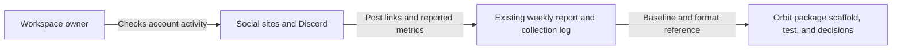
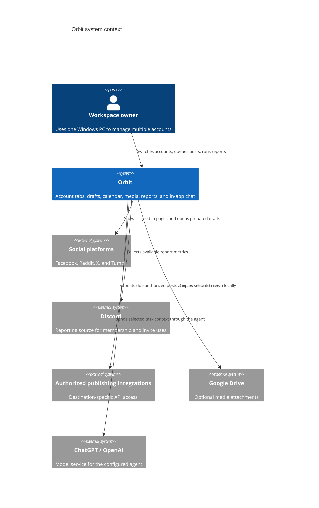
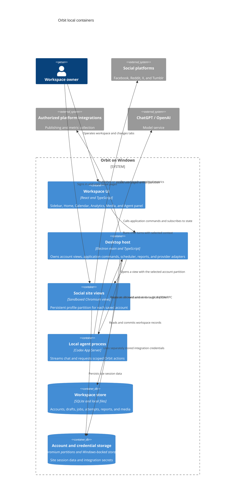
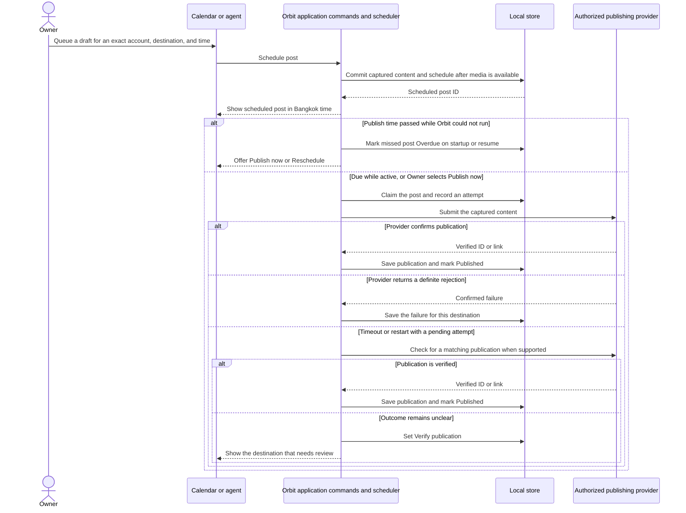
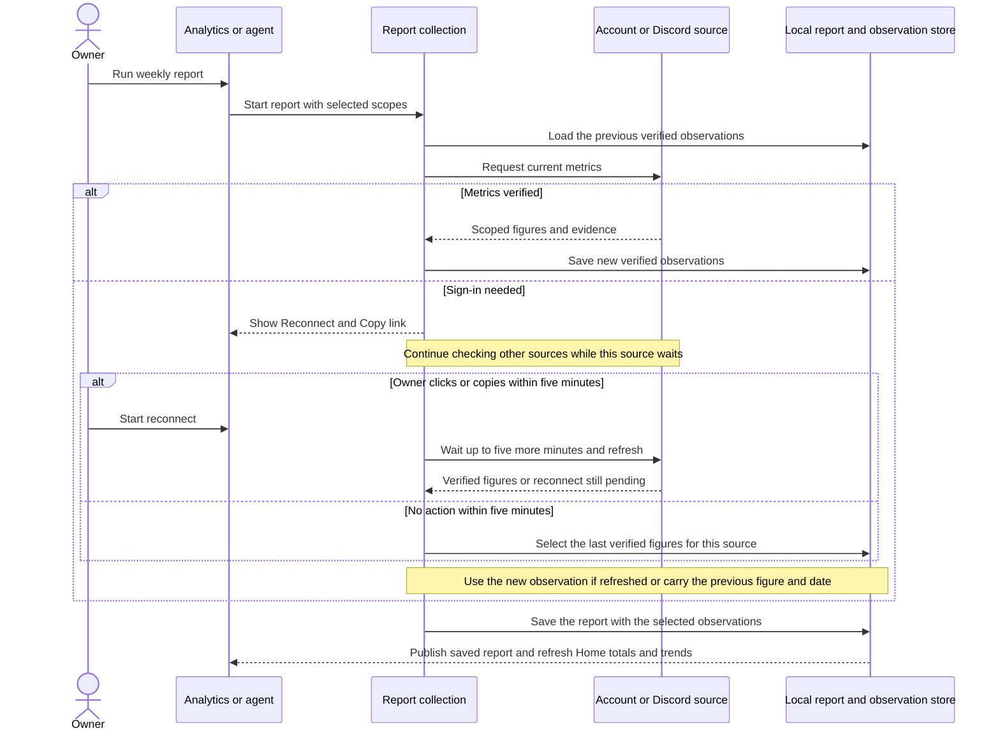
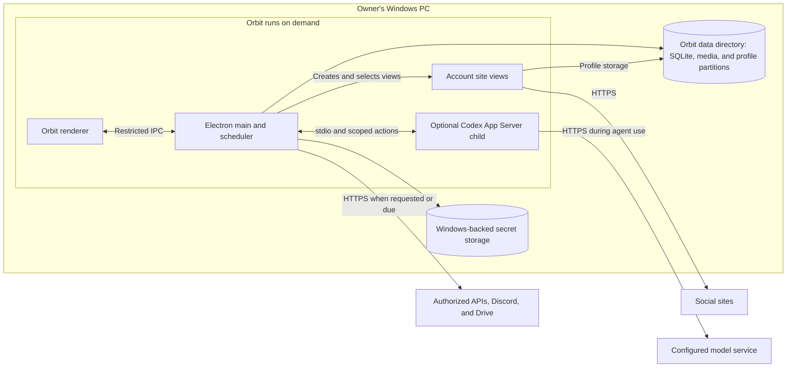
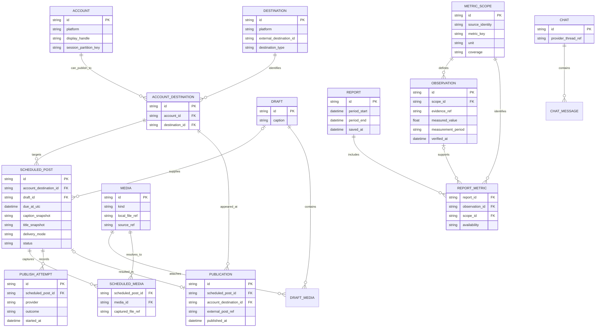

# Orbit desktop architecture

This is the proposed design for the one-owner Windows workspace. The rationale, alternatives, and verification questions are in [ADR 0008](../adr/0008-run-orbit-as-a-local-electron-application.md). The [module and local API design](orbit-module-and-local-api-design.md) describes state ownership, typed commands, and recovery.

## Current project state

Known from the local folder and product records on 2026-11-19. The November 6–15 report and its collection log are the baseline evidence. The Orbit folder contains a scaffold and decision records.

## C4 context

## C4 containers

The main process owns the application commands and durable writes. UI commands, agent requests, and scheduled jobs all reach that same boundary.

## Scheduled publishing and recovery

This sequence covers a destination with an authorized integration. The prepared draft path opens the site for the owner to finish posting.

## On-demand report

## Deployment

When Orbit exits, its scheduler also exits. SQLite records, media, and account profile data remain on disk. The app opens local tools without an agent connection. Live site access, provider calls, and cloud chat need a network connection.

## Logical data model

The account and publishing destination are independent identities. Their join records the paired target for a post. A report can refer to an earlier verified observation when a source is unavailable. That preserves the original date and prevents a carried-forward value from becoming a new chart point.

The ERD describes relationships and durable state. Table shape and indexes are implementation choices. A report entry can represent a missing value without an observation. A verified externally published post can appear on the calendar without a scheduled job when its destination, link, and publish time are known.
